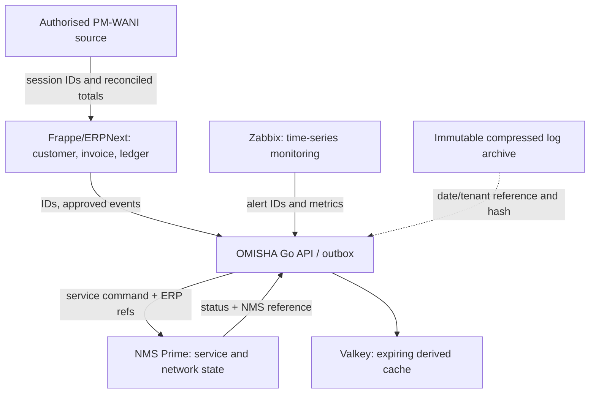

# Data ownership and duplication control

## Rule

हर business fact का एक authoritative owner रखें। बाकी systems stable source ID,
link या समय-सीमित cache रखें—customer की पूरी profile और transaction copy करके
अपना दूसरा master न बनाएं। Client separation अलग database/network boundary है;
इसका अर्थ प्रत्येक system में पूरी customer table की duplicate copy नहीं है।

## Data ownership map

| Data | Authoritative system | Other systems keep |
|---|---|---|
| Customer legal identity, contact and GST registration | Per-client ERPNext site | ERP customer ID, minimal operational contact only where NMS needs a provisioning action; no parallel editable profile |
| Invoice, payment, tax and general ledger | ERPNext | Invoice/payment reference and reconciled totals; no copy of GL into NMS |
| ISP service order and financial plan | ERPNext | Durable event outbox contains only service-order ID, event schema version and idempotency key |
| Active service, access credentials reference, network device/port/pool mapping | NMS Prime | NMS contract/service/device IDs in ERPNext; ERP must not reconstruct topology |
| Health, alarms and performance time series | Zabbix | Alert/event ID, severity, timestamp and target NMS service/device reference |
| PM-WANI authentication and session | System/provider authorised for the operator's role | External session/token reference plus reconciled financial aggregate; never mirror secrets or the full provider session store into ERP |
| Raw RADIUS/IPDR/CGNAT evidence | Ingest/archive pipeline under applicable retention | Archive URI, date range, byte count and cryptographic digest; retain full records only in mandated archive/source |
| Staff identity and HR record | Frappe HR | Minimum operator ID and role needed by support/approval audit |
| Generated government report | Reporting registry | Final approved artifact, template version, values, source IDs and source digest; do not copy all source rows/attachments into a second database |
| Attachments | One designated private file/object store or owning Frappe site | URI, owner, checksum and access policy; avoid attaching the same binary separately in NMS, ERP, email and report DB |
| API/cache response | Original system | Valkey derived value with short TTL only; cache is disposable and rebuildable |

NMS Prime contains its own CRM/BSS features. In the OMISHA configuration ERPNext
owns customer/accounting facts; map supported NMS customer/contract records to
ERP customer IDs and restrict who may update duplicated contact fields. Confirm
whether the selected NMS edition permits disabling unused CRM/BSS areas. Until
confirmed, NMS may require a minimal operational contact record; this is a
controlled projection, not a second customer master.

## Event and query contracts

- Pass `tenant_id`, stable `customer_id`, source `document_id`, schema version,
  event ID, idempotency key and required command fields. Never pass full ERP user
  profiles, payment history, GST ledger or attachments to NMS provisioning.
- Outbox and consumer store event IDs, attempt state and minimal payload. An
  external system response should store result/reference and a bounded error
  summary, not its entire HTTP response with customer data.
- Consumers retrieve current source details from the owner through an authorised
  service API only when an operation specifically requires them. Never query a
  database owned by another app directly.
- Use source IDs and foreign-reference mappings with uniqueness constraints.
  Retry the same idempotency key. Reconcile pending events and totals instead of
  creating another copy to cover uncertain delivery.
- Reporting reads NDJSON one record at a time, accumulates only requested numeric
  totals, record IDs/date and per-record hashes, then releases each input row.
  Persisted runs contain source IDs and digests, never full source rows.
- Backups and disaster-recovery replicas are intentional controlled copies:
  encrypted, access-restricted, versioned, retained under a separate recovery
  policy and restore-tested. They are not operational writable sources of truth.

## Cost and performance limits

Separate MariaDB/PostgreSQL containers per client isolate credentials, upgrades,
failure and backup sets but add RAM, disk, filesystem and backup overhead.
Container boundaries do not provide more host capacity. Keep fields normalised
inside each owning database, avoid cross-system polling loops, batch outbox
events, paginate queries and cache only small read-mostly projections. Store
high-volume logs once as compressed lossless archives and build bounded search
indexes/aggregates with links back to raw evidence.

Measure duplicate bytes by data class: source growth, report/index growth, backup
growth, cache size and attachment size. Acceptance should show a stable unique
record rate, no growing duplicate customer profile, bounded cache TTL, and report
storage proportional to fields/IDs requested—not total source rows or log volume.

## Implemented status

- Frappe ISP app inserts an outbox event in the order-submit transaction and
  sends no network request from the DocType hook.
- Report-run storage keeps source system/record IDs/date and a digest instead of
  source rows.
- Integration adapters are read-only; provisioning writes are not enabled.
- Frappe, NMS, Zabbix and n8n database separation is described in the deployment
  plan; only ERP and opt-in NMS PostgreSQL Compose configurations exist so far.
- Customer identity mapping, NMS projection policy, report aggregates, attachment
  deduplication and cross-system retention jobs still need implementation.
