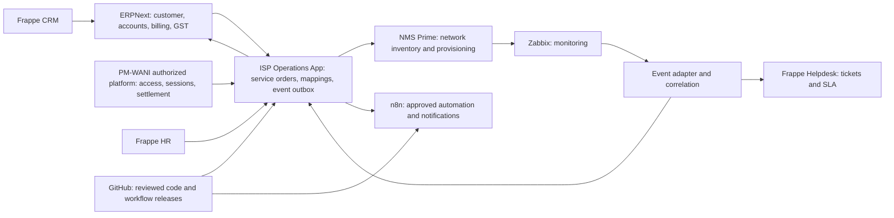
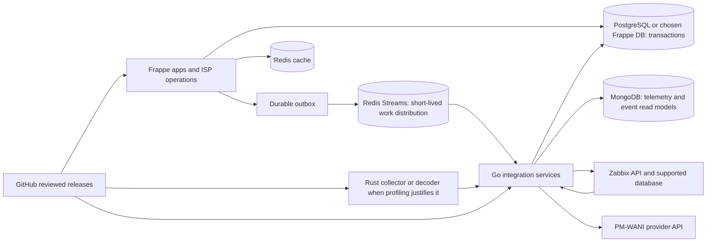
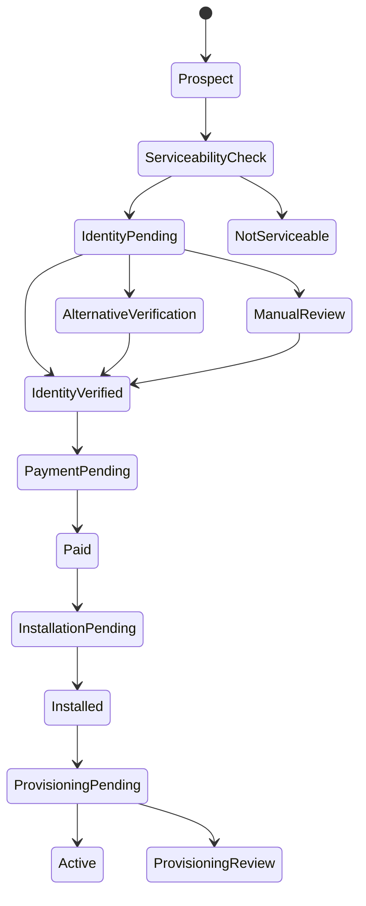

# Integrated ISP Operations Platform
## Architecture plan, requirements, and integration design

**Status:** Initial design draft  
**Prepared:** 6 October 2026  
**Scope:** NMS Prime, ERPNext CRM and accounts, Frappe Helpdesk and HR, Zabbix, PM-WANI tokens and infrastructure, n8n, GitHub, GST, and ISP statutory reporting.

## 1. Executive summary

Build an integrated operations platform for an Indian ISP using the listed products as specialist systems, with clear ownership of each business record. ERPNext is the business and financial system of record. NMS Prime remains the network/service inventory and provisioning authority where its supported interfaces allow. Zabbix is the monitoring and event source. Frappe Helpdesk owns customer support cases and SLAs. Frappe HR owns employee records and people workflows. A small ISP operations app and API adapters connect these systems; n8n handles approved workflow automation. GitHub stores reviewed application and workflow changes.

PM-WANI session authentication, authorization, accounting, hotspot control, and any required certification must be implemented in or integrated with the appointed PM-WANI role provider. Do not use ERPNext or n8n as a real-time captive portal, AAA, or usage-enforcement engine. Send validated usage and settlement records to the billing side for financial posting.

GST and regulatory reports should be generated from controlled source transactions, reviewed, and reconciled. This design does not decide which telecom reports apply to the company. The entity's authorization, service footprint, customer types, filing channels, and retention rules must be confirmed with its compliance owner and advisor.

The repository now includes a limited source foundation (Frappe ISP service-order/outbox skeleton, read-only Go adapters, report streaming, and deployment references). It is not a complete product or production deployment. The acquisition and provisioning workflow below remains a design contract until implemented and validated against the operator's authorization, payment provider, and NMS edition.

## 2. Goals and boundaries

### Goals

- Maintain a single customer/account identity across sales, service, support, billing, and monitoring.
- Link every provisioned service, network site, hotspot, access session, support case, and invoice to that identity where applicable.
- Automate routine integrations while making failures visible, recoverable, and auditable.
- Keep financial postings and statutory report preparation traceable to source records.
- Make changes to custom apps, n8n workflows, and deployment configuration reviewable in GitHub.

### Out of scope for the first release

- Replacing NMS Prime, Zabbix, ERPNext, or Frappe products.
- A new real-time ISP billing or AAA engine.
- Automatic filing or signing of GST or telecom returns before the required portal/API, authorization, reconciliation, and approval path is confirmed.
- Assuming that PM-WANI credentials mean prepaid voucher tokens. The exact token, voucher, credential, session, and settlement terms must be agreed with the PM-WANI operator/provider.
- Prescribing a telecom license, authorization, retention period, tax treatment, or statutory filing calendar.

## 3. Working assumptions and system ownership

| Area | Proposed source of truth | Notes |
|---|---|---|
| Leads and pipeline | Frappe CRM | A won opportunity converts to an ERPNext customer and a service order through an explicit handoff. |
| Legal entity, GST registrations, chart of accounts, invoices, payments, GL | ERPNext | ERPNext owns posted financial transactions. Use India Compliance features where the deployed version and configuration support the required reports. |
| Customer account and bill-to party | ERPNext | Use a stable cross-system customer UUID; retain product-specific record IDs as external references. |
| Service address, service instance, install order, lifecycle | ISP operations app initially; NMS Prime for network/device inventory and provisioning state where supported | Confirm whether NMS Prime is Cisco Prime Infrastructure or another product. Do not assume API coverage until the installed product/version is inspected. |
| Monitoring, problem and recovery events | Zabbix | Zabbix detects and updates network events; a correlation layer maps events to service/site and support case. |
| Customer support ticket, SLA, communications | Frappe Helpdesk | Ticket relates to the ERPNext customer and affected service/site through mapped identifiers. |
| Employee, leave, attendance, HR lifecycle | Frappe HR | Send only minimum staff identity/team data to Helpdesk and operational systems. |
| PM-WANI app/PDOA/central-registry and access/session records | Authorized PM-WANI system/provider | The internal app may keep references and operational status; the authorized system remains authoritative for protocol, access and required central-registry transactions. |
| Cross-system automation | ISP operations app plus durable job/outbox mechanism | Owns integration state, retries, idempotency, reconciliation, and audit metadata. |
| Notifications and low-risk business workflows | n8n | Use for orchestration and alerts. Do not make a workflow graph the only durable ledger or source of truth. |
| Source and release history | GitHub | Keep credentials out of the repository; use protected deployment environments for production releases. |

The exact hosting and Frappe app layout is a deployment decision. ERPNext, CRM, Helpdesk, and HR can share a compatible Frappe site where version compatibility and access boundaries are acceptable. Keep Helpdesk on a separate site if its security, availability, or scaling needs require isolation. Verify app version compatibility before choosing either layout.

## 4. Target architecture

The architecture separates business records from integration transport. Product adapters call documented APIs or authenticated webhooks. All cross-system writes carry a source ID and idempotency key. An integration event/outbox records the request, outcome, retry state, and correlation ID. n8n consumes only the events and data needed for the approved workflow.

### Main components

1. **Frappe business applications:** ERPNext, CRM, Helpdesk, HR, and a version-controlled custom app tentatively named isp_ops.
2. **ISP operations app:** service orders, service instances, site/customer mappings, integration configuration, idempotency records, event outbox, retry/reconciliation screens, and audit trail. It should extend standard DocTypes only where practical and keep provider-specific payloads out of core accounting records.
3. **Integration adapters:** narrow modules for NMS Prime, Zabbix, PM-WANI provider, and ERPNext/Helpdesk APIs. Each adapter validates and translates payloads; provider credentials are scoped and separately rotated.
4. **Durable asynchronous processing:** use the Frappe background-job queue/outbox for normal integration work. Add a dedicated message broker only if measured throughput, availability, or independent scaling requires it.
5. **n8n:** human-readable workflows for notifications, approvals, and noncritical cross-system tasks. Business-critical provisioning, billing state, access control, and reconciliation retain code-owned validation and durable state.
6. **GitHub delivery:** pull requests, versioned migrations, configuration review, environment-specific deployment, and release records.

## 5. Detailed functional requirements

Priority meanings: **P0** required for a controlled first production release; **P1** valuable after the core flows work; **P2** later enhancement. Each requirement needs business-owner sign-off and testable acceptance criteria during implementation.

| ID | Priority | Requirement |
|---|---|---|
| FR-001 | P0 | Maintain legal company records, branches/GST registrations, fiscal year, chart of accounts, cost centers, bank/payment modes, and approval roles in ERPNext. |
| FR-002 | P0 | Create a stable customer UUID and preserve mappings to CRM, ERPNext, Helpdesk, NMS Prime, Zabbix assets, and PM-WANI provider IDs. Prevent duplicate conversion of a CRM lead/opportunity into a customer. |
| FR-003 | P0 | Capture customer contacts, service/billing addresses, tax identifiers as permitted, consent/communication preferences, and account status with field-level access where appropriate. |
| FR-004 | P0 | Convert an approved CRM opportunity into an ERPNext customer/account and a service order with plan, service location, quoted charges, tax category, requested dates, and approvals. |
| FR-005 | P0 | Manage service lifecycle states: draft, approved, ready to provision, provisioning, active, suspended, cancellation requested, cancelled, and failed. Record who/what changed state, when, and why. |
| FR-006 | P0 | Submit provisioning requests to NMS Prime through a supported and authenticated interface; store request/response IDs; poll or accept callbacks; show timeout and manual-recovery states. Never mark a service active solely because a request was sent. |
| FR-007 | P0 | Maintain a mapping from customer and service instance to network device/site, access circuit, plan, monitoring identifiers, and PM-WANI hotspot/provider references as applicable. |
| FR-008 | P0 | Ingest Zabbix problem and recovery events, validate source identity, deduplicate by event identity, map affected devices/services, and link or update Helpdesk tickets under defined outage rules. |
| FR-009 | P0 | Create and update Helpdesk tickets for customer-reported cases and qualifying alerts; include customer/service/site references, priority, ticket type, source event, and SLA. A recovery event updates the incident; it does not silently close customer cases that need confirmation. |
| FR-010 | P0 | Provide agents with relevant customer account status, affected service, open incident, and recent ticket context using permission-checked links or a minimal synchronized view. |
| FR-011 | P0 | Produce billing inputs from approved recurring charges and validated usage/settlement records. Do not invoice raw, duplicated, or unvalidated session events. |
| FR-012 | P0 | Generate ERPNext invoices with traceable source service/usage references; handle invoice adjustments and credit/debit notes with explicit reasons and approvals. |
| FR-013 | P0 | Record receipts and allocate them to invoices; expose outstanding balances to approved support and operations roles; enforce approved suspend/restore rules. |
| FR-014 | P0 | Keep draft GST/statutory reports tied to an accounting period, source snapshot, generation time, preparer, reviewer, reconciliation status, and submitted-file/reference where one exists. Filing/signing remains an authorized human or confirmed certified integration action. |
| FR-015 | P0 | Keep an integration operations screen for failed, delayed, duplicate, and manually corrected messages, with replay controls guarded by idempotency and role checks. |
| FR-016 | P1 | Represent PM-WANI PDO/PDOA/App Provider/hotspot relationships and registry/provider identifiers according to the company's approved role and provider contract. |
| FR-017 | P1 | Record PM-WANI access credential/token lifecycle only after its meaning is agreed: issue/provision, expiry, revoke, usage/session reference, provider response, and settlement reference. Avoid storing reusable plaintext secrets. |
| FR-018 | P1 | Import PM-WANI session/usage/settlement summaries from the authorized provider, reconcile totals and exception counts, and stage eligible charges for ERPNext billing. |
| FR-019 | P1 | Provide dashboards for sales-to-activation time, active/suspended services, provisioning failures, outage impact, ticket SLA, billed usage, collections, and compliance preparation status. |
| FR-020 | P1 | Use Frappe HR for employee onboarding/offboarding, leave, attendance, and role lifecycle; disable access in connected tools through an approved offboarding workflow. |
| FR-021 | P1 | Manage customer complaints and outage communications with templates, approval, and delivery records; honor the customer's communication preferences. |
| FR-022 | P1 | Automate low-risk notifications, reminders, and internal task routing in n8n with workflow ownership, version, execution log, and failure alert. |
| FR-023 | P1 | Deploy custom Frappe app changes and n8n workflow exports from GitHub using separate development, staging, and production configurations and a reviewed release record. |
| FR-024 | P2 | Add customer self-service for invoices, ticket status, service requests, and PM-WANI access help after identity, authorization, and privacy requirements are defined. |
| FR-025 | P2 | Add capacity, churn, network quality, revenue, and workforce analytics with documented metric definitions. |

## 6. Integration design

### Integration rules

- Prefer vendor-supported REST APIs and signed webhooks. Do not read/write another product's database directly.
- Normalize inputs to a versioned internal event envelope: event_id, event_type, schema_version, occurred_at, source_system, source_record_id, customer_uuid/service_uuid when known, correlation_id, idempotency_key, and payload.
- Use at-least-once delivery plus idempotent consumers; do not assume a webhook is delivered exactly once.
- Persist before acknowledging important events. Retry transient failures with bounded exponential backoff and jitter; place exhausted events in a dead-letter/review queue.
- Store both external IDs and internal UUIDs. Do not join records by customer name, email, phone, or IP address alone.
- Keep immutable financial and access-session source records. Corrections create adjustment/reversal records with a reason and reference.
- Minimize payloads and log metadata/status rather than credentials, personal message contents, or full raw session data.
- Version payload schemas and retain backward-compatible consumers through planned migration windows.

### Interface matrix

| Producer -> consumer | Trigger and payload | Processing and recovery |
|---|---|---|
| CRM -> ERPNext/isp_ops | Approved opportunity; customer, contact, selected plan, service location, quoted charges and approval refs | Upsert by CRM ID plus stable UUID. Reject incomplete tax/address/service data to a visible review queue. |
| ERPNext/isp_ops -> NMS Prime | Approved service order or lifecycle change; service UUID, site, plan/profile, requested action and correlation ID | Adapter calls the installed product's documented API. Store job ID and status; poll/callback; retry safe requests; send unsupported actions to manual work queue. |
| NMS Prime -> isp_ops | Provisioning result, service/device IDs, state and failure details | Validate source, map to service UUID, update state only on authoritative result, raise alert on prolonged pending/failure. |
| Zabbix -> event adapter -> Helpdesk | Problem/recovery event ID, trigger, severity, tags, host/device, event time and status | Webhook or API poll, validate, normalize, map impact, deduplicate, upsert outage ticket, add event-to-ticket mapping. Recovery updates event state and communication tasks. |
| PM-WANI provider -> isp_ops | Provider-defined hotspot, credential/token status, session/usage/settlement summary and provider references | Implement against the selected provider's current API/certification specification. Validate signatures, timestamps, sequence/duplicates, and reconcile totals. |
| isp_ops -> ERPNext | Approved recurring/usage billing batch; account, item/plan, period, tax treatment, quantity, source refs | Create draft invoices/batch rows first; validate totals and duplicates; submit only after business approval or approved auto-post rule. |
| Helpdesk -> ERPNext/isp_ops | Ticket/account action outcome, service request, complaint reference | Update only approved fields and show an authenticated link to the ticket. Don't copy unrestricted ticket content into finance records. |
| Frappe HR -> connected roles | Joiner/mover/leaver status and role/team mapping | Provision least privilege; offboarding disables access, revokes integration credentials if applicable, and preserves audit evidence. |
| isp_ops/n8n -> customer channels | Approved notifications, reminders, ticket updates and outage notices | Use approved templates, consent/preferences, delivery status, retry limits, and a manual suppression control. |
| GitHub -> application/n8n environments | Reviewed release artifacts, migrations, workflow exports, version and deployment metadata | Deploy first to development/staging; validate configuration; require production environment gate and capture release ID/rollback plan. |

### Core business flows

**Lead to active service:** CRM opportunity won -> ERPNext customer and draft service order -> address/plan/tax validation -> approval -> NMS Prime provisioning request -> authoritative result -> active service -> first billing schedule. A failure remains visible as a provisioning task and does not generate recurring billing until activation policy permits it.

**Alarm to customer incident:** Zabbix problem -> event validation and device/service mapping -> outage correlation -> Helpdesk incident/ticket -> affected-service list -> approved customer communications -> Zabbix recovery -> ticket update and impact review -> closure under support policy. Correlation thresholds, ticket merge behavior, and customer messaging are configurable policy.

**Usage to invoice:** PM-WANI/NMS provider usage or settlement summary -> signature and duplicate checks -> usage staging ledger -> count/amount reconciliation -> approved billing batch -> ERPNext draft invoice -> tax/accounting validation -> approval/posting -> invoice and source references. Missing or late usage creates an exception rather than an assumed zero.

**Employee offboarding:** Frappe HR exit approval -> integration job revokes connected app access/API credentials and removes assigned operational roles -> results are confirmed or escalated -> HR record keeps the completion audit. Payroll and sensitive HR data remain confined to HR/payroll permissions.

### Example normalized event

    {
      "event_id": "provider-event-123",
      "event_type": "network.problem",
      "schema_version": 1,
      "occurred_at": "2026-10-06T10:00:00Z",
      "source_system": "zabbix",
      "source_record_id": "98765",
      "customer_uuid": "cust-uuid-if-known",
      "service_uuid": "svc-uuid-if-known",
      "correlation_id": "trace-uuid",
      "idempotency_key": "zabbix:98765:problem",
      "payload": {
        "host_id": "host-42",
        "severity": "high",
        "state": "problem",
        "tags": ["site:branch-7"]
      }
    }

This envelope is an internal contract example, not a Zabbix or PM-WANI wire format.

## 7. Core data model

| Entity | Key fields and relationships |
|---|---|
| Customer Account | customer_uuid, ERPNext customer ID, legal/display name, account status, billing profile, consent flags |
| Contact | contact_uuid, customer_uuid, contact channels, role, contact preferences |
| Company/GST Registration | company_id, branch, GSTIN, state, effective dates, filing configuration and access roles |
| Product/Plan | plan_id, item code, recurring/one-time charges, tax category, bandwidth/entitlement parameters and effective dates |
| Service Order | order_uuid, customer_uuid, plan_id, service address, approval references, requested dates, provisioning state |
| Service Instance | service_uuid, customer_uuid, site/device/circuit references, provider IDs, activation/suspension/cancellation history |
| Network Asset/Site | asset UUID, NMS Prime ID, Zabbix host ID, site, topology links, operational status |
| PM-WANI Hotspot/Provider Reference | internal UUID, role, PDO/PDOA/App Provider/provider IDs, access point, registry state and certification evidence references |
| Access Credential/Token | opaque reference or one-way verifier, type, issuer, subject, valid period, revoke state; never plaintext reusable secret by default |
| Session/Usage Record | provider event/session ID, service/customer reference, start/end, measured quantity, rated quantity, amount, tariff version, settlement and reconciliation state |
| Support Ticket/Incident | Helpdesk ticket ID, customer_uuid, service_uuid, source alarm IDs, SLA, status and impact/communications |
| Invoice/Billing Batch | ERPNext invoice ID, period, customer/service references, source usage IDs, approval, tax and reconciliation state |
| Integration Event | event_id, source, schema, idempotency_key, correlation_id, payload reference, attempt count, status, timestamps, error category and operator actions |
| Compliance Run | report type, legal entity/registration, period, source snapshot, prepared/reviewed/submitted status, output hash and portal reference |
| Employee Access Mapping | HR employee ID, external user IDs, mapped team/role, effective dates, provisioning/offboarding outcome |

Retention, masking, data-subject rights, and evidence access must be defined per data class and applicable policy before production.

## 8. Security, reliability, and operations requirements

- Use TLS for all external and internal API traffic; restrict inbound webhook exposure and authenticate callers. Use allowlists only as an additional control, not as the sole authentication method.
- Create separate service identities per integration and environment, with least-privilege roles, expiry/rotation, and an owner.
- Store secrets in a secrets manager or protected environment configuration. Do not commit secrets to GitHub or paste them into n8n workflow definitions.
- Require MFA for administrators and sensitive roles; use role and company/branch permissions plus field-level controls for tax, HR, finance, and customer data.
- Keep auditable records for financial posting, provisioning, access changes, token revocation, data export, manual replay, and report approval.
- Redact API keys, OTPs, tokens, payment credentials, and sensitive personal fields from logs and error messages.
- Encrypt backups and test restore procedures. Define backup frequency, recovery point objective, recovery time objective, availability target, and retention with the business owner before launch.
- Monitor API health, queue age, retry count, dead-letter volume, webhook rejection, provisioning lag, invoice batch exceptions, session reconciliation variances, ticket SLA, and backup status.
- Define ownership and escalation for every connector, workflow, queue, and external provider. Provide runbooks for credential rotation, provider outage, replay, reconciliation, rollback, and restore.
- Keep separate development, staging, and production environments. Production deployment requires a reviewed change, migration plan, backup/rollback plan, and authorized release gate.

## 9. GST and ISP statutory reporting approach

Treat reporting as controlled preparation and reconciliation, not an assumption that every filing is automated.

1. Confirm the legal entity, GST registrations, branch locations, supply categories, invoicing model, filing frequency, and required return/report types with the accountant/compliance owner.
2. Configure ERPNext Company, GSTIN/branch/address, customer/supplier tax details, service item/SAC, tax templates, chart of accounts, and India Compliance app as applicable to the chosen version.
3. Define ISP service revenue, installation charges, equipment sales/rentals, discounts, credits, deposits, advances, refunds, and PM-WANI settlements as explicit accounting/tax mappings.
4. Reconcile source invoices and credit/debit notes to the output summaries for each reporting period; record exceptions and reviewer sign-off.
5. Maintain a versioned compliance catalogue: report/return name, authority, entity/registration scope, period, source, preparation method, due date source, responsible person, evidence, approval, submission reference, retention, and change history.
6. For telecom/statutory reporting, identify each required return only after the company's current authorization/service category and applicable DoT/other authority instructions are confirmed. Support configurable extract generation and review rather than hardcoding a presumed return list.
7. Only submit or sign using an authorized portal, GSP, or provider integration with current official specifications and explicit approval.

## 10. Delivery plan and acceptance gates

### Phase 0 - Discovery and interface verification

- Confirm the exact NMS Prime product/vendor/version and inspect its API, event, provisioning, and support interfaces.
- Confirm ERPNext/Frappe CRM, Helpdesk, HR, and India Compliance versions and hosting model.
- Confirm company structure/GSTINs, service catalogue, billing model, network identifiers, PM-WANI role/provider, and reporting catalogue.
- Produce field mappings, role matrix, event schemas, environments, and migration/source-data inventory.

**Gate:** Each external system has a named owner, test endpoint or export, authentication method, data dictionary, and supported failure/recovery behavior.

### Phase 1 - Customer, service and support foundation

- Implement stable customer/service identifiers, CRM-to-ERP handoff, service order lifecycle, NMS Prime adapter, Zabbix event intake, and Helpdesk ticket linkage.
- Provide dashboards for integration failures, provisioning state, incidents, and account/service lookup.

**Gate:** A test customer can move from approved opportunity to provisioned service; a synthetic Zabbix problem and recovery create/update the correct support record without duplicates.

### Phase 2 - Billing, payments and GST controls

- Implement validated recurring and approved usage billing batches, invoice traceability, receipts, aging, and draft reporting/reconciliation.
- Add approval and segregation-of-duties controls.

**Gate:** An invoice can be traced to customer, active service, approved plan/rate, billing period, source events, tax configuration, and approver; duplicate source events cannot create duplicate charge lines.

### Phase 3 - PM-WANI and automation

- Integrate the approved PM-WANI provider's hotspot, token/credential, session, usage, and settlement interfaces; complete its certification requirements where applicable.
- Add carefully scoped n8n notifications and low-risk workflows; manage workflow export/release through GitHub.

**Gate:** A provider sample session reconciles from source through staging into an approved billing entry, with duplicate, invalid-signature, late-event, and outage cases visible.

### Phase 4 - HR lifecycle, self-service and analytics

- Connect joiner/mover/leaver access actions, expand customer self-service, and publish governed management analytics.

**Gate:** Access lifecycle, support privacy, metric definitions, restore, and operational runbooks are signed off.

## 11. Initial acceptance criteria

- One customer UUID links CRM, ERPNext, Helpdesk, service instance, NMS Prime, and monitoring references without name-based matching.
- Replayed webhook or event messages do not create duplicate service actions, tickets, usage, or invoice lines.
- Every failed integration is visible with reason, owner, age, retry/replay history, and correlation ID.
- Service state and billing start are driven by defined authoritative transitions and business policy.
- A network problem and recovery are represented as one correlated incident lifecycle where rules match; unrelated alarms remain separate.
- Usage can be reconciled by provider, period, quantity, charges, and exception reason before invoice generation.
- Draft compliance outputs have source and period traceability and require the defined reviewer before filing.
- Secrets are absent from repository content, application logs, and exported n8n workflow files.
- A production release can be tied to a reviewed GitHub change and can be rolled back using the documented process.

## 12. Decisions required before implementation

1. What does NMS Prime refer to exactly (vendor, product, version, deployment)? Is it the authoritative provisioning system, an inventory UI, or both?
2. Which entity and telecom authorization/service categories apply, and what exact statutory reports, periods, submission channels, and retention rules are required?
3. Is the company acting as a PM-WANI PDO, PDOA, App Provider, or using a third-party provider? Which platform/API and certification version are in scope?
4. What does “token” mean in this project: voucher, captive-portal access credential, API token, or provider-issued session token?
5. Is billing postpaid recurring, prepaid, usage-based, or a combination? What are the rating source, billing calendar, proration, tax, deposits, dunning, suspend/restore, and adjustment rules?
6. Is “company account” the accounting ledger/chart of accounts and bank/payment setup, or does it also mean company login/identity management?
7. Which Frappe/ERPNext/CRM/Helpdesk/HR versions and hosting topology are planned? Should Helpdesk share the ERPNext site?
8. What are expected customer, service, hotspot, event, invoice, and concurrent-user volumes? What availability, recovery, and data-retention targets are required?
9. Which customer channels and payment, SMS/email, identity, e-invoice/GSP, and network vendors must be integrated?
10. Where does the actual application source repository live? The current project directory has no code or configuration to modify yet.

## 13. Reference documentation

- Frappe REST API and token authentication: https://docs.frappe.io/framework/user/en/api/rest
- Frappe Helpdesk integration and ticket model: https://docs.frappe.io/helpdesk/ and https://docs.frappe.io/helpdesk/ticket
- Frappe Helpdesk installation alongside an existing ERPNext site: https://docs.frappe.io/helpdesk/installation
- Zabbix webhook integration guidance: https://www.zabbix.com/documentation/guidelines/en/webhooks
- n8n Webhook node, authentication, production/test endpoints, and payload limits: https://docs.n8n.io/integrations/builtin/core-nodes/n8n-nodes-base.webhook/
- Department of Telecommunications PM-WANI Service Authorisation: https://www.eservices.dot.gov.in/pm-wani-service-authorisation
- Department of Telecommunications PM-WANI Guidelines: https://www.eservices.dot.gov.in/sites/default/files/2024-11/PM-WANI_Guidelines.pdf
- GST Portal GSTR-1 guide: https://tutorial.gst.gov.in/userguide/returns/GSTR_1.htm
- ERPNext India Compliance overview: https://docs.frappe.io/erpnext/v12/user/manual/en/regional/india/gst-setup
- Cisco Prime Infrastructure REST API reference landing page (relevant only if this is the product in use): https://www.cisco.com/c/en/us/support/cloud-systems-management/prime-infrastructure/products-programming-reference-guides-list.html

Documentation confirms available integration mechanisms and product capabilities; the final behavior still depends on the installed product versions, selected providers, company configuration, and applicable current requirements.

## 14. Performance architecture update: MongoDB, PostgreSQL, Redis, Go, and Rust

This section records the requested technology direction and supersedes the generic queue/database notes in Sections 4 and 8. It is designed to reduce routine PostgreSQL write and query pressure by moving high-volume telemetry and read workloads off the transactional path. It does not assume that changing languages or adding a database automatically makes the whole system faster. Baseline and post-change measurements are required.

### Recommended data placement

| Technology | Proposed workload | Keep out of this store |
|---|---|---|
| PostgreSQL | Existing transactional application records where already deployed and supported: customer/service state, approvals, billing summaries, integration outbox, and audit references. Keep invoice, payment, GL, and report approval transactions relational and authoritative. | High-rate raw device samples, duplicate event payload copies, unbounded execution logs, dashboard scans over raw telemetry. |
| Frappe site's supported database | ERPNext, CRM, Helpdesk, HR, and custom Frappe DocTypes. Select PostgreSQL or MariaDB only after checking the exact Frappe and app versions and deployment support. This may be the same PostgreSQL cluster or a separate database instance. | Do not replace the Frappe transactional database with MongoDB. |
| MongoDB | High-volume append-oriented telemetry samples, normalized raw network event history, and denormalized operational read projections that need time/device queries. Use time-series collections for suitable timestamped measurements; keep metadata stable, index by device/site and time, and define archival/retention. | General ledger, invoices, payments, authoritative customer identity, mutable service state, or workflow approvals. Do not make MongoDB the only copy of billable usage evidence without a signed-off durability, audit, backup, and reconciliation design. |
| Redis | Frappe cache/job queues, hot reference-data cache, short-lived idempotency/lock coordination, rate limits, and bounded low-latency work streams. Separate cache, Frappe queue, and high-volume integration stream workloads operationally so one queue cannot evict or starve another. | Sole copy of a financial, service lifecycle, or statutory record. Do not use cache-only Redis keys as the durable event ledger. |
| Object/archive storage (if available) | Compressed long-term raw telemetry/event export and generated report evidence when required retention exceeds hot-database economics. | Interactive low-latency operational state. |

**PostgreSQL load reduction path:** keep business transactions and durable outbox records in the transactional database; batch and asynchronously export raw telemetry/duplicate event history into MongoDB; serve telemetry-heavy dashboards from MongoDB read projections; cache stable reference data and frequent lookups in Redis; expire/archive raw data only under approved retention policy; and tune the PostgreSQL/Zabbix workload with measured query, index, vacuum, partition/retention, and connection-pool evidence. This moves expensive read/write volume where the data shape fits instead of scattering every record across every store.

### Updated data flow

The diagram shows logical workloads, not a mandate to run every database in one cluster. The existing PostgreSQL instance, Frappe database, and Zabbix database may be separate. Size, isolate, back up, and monitor each according to its workload and failure domain.

### Database and integration safeguards

- The relational transaction remains authoritative for account, service lifecycle, billing, approvals, and the outbox. Commit the business update and outbox row atomically, then publish asynchronously. Consumers must remain idempotent.
- Write telemetry to MongoDB in bounded batches. Store stable device/site metadata in the time-series meta field and time as the time field. Define indexes from actual dashboard queries, not guesses.
- Keep event identity and billing reconciliation keys durable in PostgreSQL or another explicitly approved durable ledger. Redis is an accelerator/distribution layer; if it loses messages during failure, the outbox can republish them.
- Use Redis Streams consumer groups for bounded work queues only with explicit max length/trim policy, pending-message recovery, consumer acknowledgments, monitoring, and persistence/failover settings. Redis documents persistence and replication tradeoffs, so a Redis stream is not the sole source of financial or regulatory evidence.
- Keep Zabbix on a database it supports. Its server/database workload remains separate from MongoDB telemetry archives; MongoDB is not a drop-in Zabbix backend. If Zabbix's PostgreSQL history is the measured bottleneck, tune retention/history/trends, partitioning or the supported time-series extension for the installed Zabbix version, and use an export/archival path before shortening hot retention.
- MongoDB TTL expiration is asynchronous rather than an exact deletion deadline. Do not use TTL as a legal retention or deletion guarantee; use a governed purge/archive job with audit evidence where exact policy compliance is needed.
- Do not synchronously dual-write the same authoritative record to PostgreSQL and MongoDB. Use an outbox or change event, replay-safe consumers, and periodic count/sum/reconciliation checks.
- Cache only rebuildable data. Define TTL and invalidation for each cache class; use versioned keys or event-driven invalidation where stale service/account status could cause operational mistakes.
- Do not choose MongoDB solely to reduce PostgreSQL size. Profile query load, table growth, WAL/checkpoint pressure, locks, slow queries, and storage before and after moving a workload.

### Language placement

- **Go is the default for new high-concurrency services:** webhook/event ingress, Zabbix and provider API adapters, normalization, durable outbox/Redis consumers, and high-throughput usage import. Go's concurrency and networking support suit these services; it does not remove the need for backpressure, batching, connection limits, or profiling.
- **Rust is reserved for measured hot paths:** high-rate SNMP/stream decoding, binary protocol parsing, packet/session processing, or CPU/memory-constrained collectors where benchmarks show Go is insufficient. Keep these services narrow and expose versioned HTTP/gRPC or message contracts.
- **Frappe business workflows stay in Frappe/Python** where they need ERPNext documents, permissions, accounting validation, and migrations. Keep n8n for reviewed low-code notifications and light orchestration. Avoid rewriting the ERP layer in Go/Rust, which would duplicate business rules and authorization.
- Start with Go and existing platform services; introduce Rust only after load testing identifies a concrete CPU, memory, or latency bottleneck. Two compiled languages increase build, on-call, release, and hiring costs, so each Rust service must have a named owner and benchmark.

### Performance requirements to add to implementation

| ID | Priority | Requirement |
|---|---|---|
| NFR-P01 | P0 | Establish a baseline for PostgreSQL/Frappe/Zabbix CPU, memory, storage growth, IOPS, connection count, slow queries, lock time, WAL/checkpoint activity, queue age, and API p50/p95/p99 latency under representative daily and peak load. |
| NFR-P02 | P0 | Set business-approved throughput, latency, availability, recovery, and retention targets before final capacity sizing. No throughput or latency figure is assumed by this draft. |
| NFR-P03 | P0 | Route only append-heavy raw telemetry and agreed read projections to MongoDB; keep financial, approval, identity, and service lifecycle records in their authoritative transactional system. |
| NFR-P04 | P0 | Ensure every asynchronous event can be replayed from a durable outbox or provider source after Redis or worker failure, without duplicate business effects. |
| NFR-P05 | P0 | Measure whether moving a workload reduces PostgreSQL daily write volume, query latency, and storage growth; retain the change only if acceptance targets improve without breaking reconciliation or retention controls. |
| NFR-P06 | P1 | Batch writes, bound concurrency, use connection pools, cache frequently read reference data, and provide backpressure during provider or database slowdowns. |
| NFR-P07 | P1 | Benchmark Go services and any proposed Rust hot path using representative event sizes, peak rates, failure/retry patterns, and resource limits before production rollout. |
| NFR-P08 | P1 | Define MongoDB replica/backup/restore, Redis persistence/failover, PostgreSQL recovery, retention/archival, and cross-store reconciliation runbooks for each environment. |

### Decisions added to the open-questions list

- Is PostgreSQL currently the Frappe database, the Zabbix database, a separate NMS Prime database, or more than one of these? Confirm exact versions, measured daily bottlenecks, and whether each database can be tuned or scaled independently.
- Which telemetry and event classes, volumes, query patterns, and retention periods should move to MongoDB? Which source must retain the billable/certification-grade record?
- Is Redis already used by Frappe for cache and job queues? If so, what deployment isolation and persistence/failover guarantees are available?
- What baseline and target performance measures should define success for the proposed Go services and any Rust component?

### References for this update

- Frappe database types and setup: https://docs.frappe.io/framework/user/en/guides/database-settings/postgres-database-setup and https://docs.frappe.io/framework/user/en/basics/site_config
- MongoDB time-series collections: https://www.mongodb.com/docs/manual/core/timeseries/timeseries-procedures/
- MongoDB time-series data model: https://www.mongodb.com/docs/v8.0/core/timeseries/timeseries-bucketing/
- MongoDB time-series expiration behavior: https://www.mongodb.com/docs/manual/core/timeseries/timeseries-automatic-removal/
- Redis Streams and delivery/persistence tradeoffs: https://redis.io/docs/latest/develop/data-types/streams/
- Zabbix supported database setup: https://www.zabbix.com/documentation/current/en/manual/appendix/install/db_scripts
- Go official language documentation: https://go.dev/doc/
- Rust official language book: https://doc.rust-lang.org/stable/book/ch00-00-introduction.html

## 13. Customer acquisition and automated onboarding

Customer acquisition has two entry channels and one shared workflow. A self-service customer and a technician-assisted customer must not create separate customer masters or bypass the same eligibility, identity, payment, approval, and provisioning state machine.

### Channel A: customer self-registration

1. Customer signs up on the branded web portal or Flutter customer app using verified mobile/email and chooses an available plan.
2. The Go customer API checks serviceability for the requested address using the approved coverage source. It creates or resumes a single ERPNext Lead/Prospect using a channel idempotency key and duplicate-candidate checks. Similar phone/name matches are review candidates, not automatic merges. Aadhaar number is never the customer deduplication key.
3. The portal explains the applicable identity process, purpose, fields, retention and alternatives in Hindi and English, obtains and records consent, and starts the operator-approved subscriber verification route.
4. If Aadhaar offline verification is legally available for the operator and method, validate the supported digitally signed QR/e-Aadhaar/offline XML or other currently approved credential. Store the verification outcome, method, timestamp, consent receipt, verifier version, and minimal reference/masked attributes only. Do not persist the full Aadhaar number, raw QR payload, XML, share phrase, OTP, biometric, or full document image in normal application tables, logs, analytics or Git. Delete temporary artifacts after verification unless an explicit, lawful retention rule requires otherwise.
5. If the customer chooses or needs an alternative, route to the configured accepted document/manual verification path. Do not make Aadhaar the only path unless the operator's legal/compliance owner confirms the exact basis and process.
6. Customer pays through ERPNext's standard Payment Request and a configured hosted/approved gateway. ERPNext Payment Request/Payment Entry own the transaction reference, amount, currency, allocation and payment state. The Acquisition Request stores only a Link to its Payment Request, not a second payment record. Never collect/store card number, UPI PIN, CVV or payment credentials. A browser success redirect or screenshot is not payment proof.
7. Payment webhook signature and amount/order match are verified server-side. The provider event ID and order idempotency key prevent duplicate payment posting. ERPNext owns the Sales Order/invoice/payment allocation; repeated webhook deliveries reconcile to the same transaction rather than create another entry.
8. A common service order advances only when required identity checks, serviceability, terms, and payment/credit policy are satisfied. It then enters survey/installation or the configured no-install service path. Service activation waits for the approved network integration's acknowledgement and an end-to-end service test.

### Channel B: technician-assisted registration

1. A technician signs in to the technician Flutter app or responsive portal with a separate workforce identity, MFA, assigned territory/role, and device/session controls.
2. The technician creates or resumes the same ERPNext Lead/Prospect and service order through the same Go API. The source channel and assigned technician ID are audit metadata; customer, plan and identity records are not copied to a technician-only database.
3. Customer consent and verification use the same approved methods and requirements as self-service. A technician may assist with capture/verification only where the chosen method and operator policy permit it; the technician cannot mark a failed or absent check as verified.
4. If connectivity is unavailable, the app may queue only a short-lived encrypted draft of non-sensitive order fields, with local access controls and explicit expiry. It must not queue raw Aadhaar files, biometrics, OTPs, payment secrets or identity payloads for later background sync. Identity proof and payment must be verified online or via a separately approved offline process before activation.
5. Installation evidence is limited to the assigned order: equipment serial/MAC, checklist, completion timestamp, and customer acknowledgement. Location/photo collection is purpose-limited, consented where required, access-controlled and retention-bounded.
6. The order follows the same server-side state machine as self-registration. Technician completion is evidence for the workflow; it does not directly change NMS state, create a payment, or bypass finance/compliance checks.

### Shared state machine and service roles

The state machine is owned by the server-side ISP Operations app. Every transition records actor/service identity, timestamp, correlation ID, policy/version, and idempotency key. Customer, technician, finance/reconciliation, compliance reviewer, installer, and integration worker have distinct permissions. A tenant is resolved from the authenticated client/site connection; a client-supplied tenant field never grants access. Suspended, cancelled, refunded, rejected and manual-review branches must be implemented before live billing/provisioning.

### System ownership and integration boundary

- ERPNext owns the Lead/Customer, Sales Order, invoice, payment posting and GST accounting. Convert prospect to Customer once according to configured conversion policy.
- The ISP Operations app owns the acquisition/service-order state machine and cross-system correlation IDs; it keeps verification references and workflow events, not duplicate customer/payment profiles.
- The identity verification adapter returns a bounded decision and reference. It must not expose raw Aadhaar artifacts to Go logs, n8n, Zabbix, analytics or the NMS.
- The payment provider owns payment credentials and payment authorization. ERPNext stores financial transaction records; the integration layer stores provider references and webhook replay keys.
- NMS Prime remains owner of the network contract/service and device/topology state. Its generic Contract create/update endpoints exist, but replay safety and side effects are not established. Do not auto-provision from either acquisition channel until the NMS write contract and idempotency/reconciliation are approved.
- Zabbix receives operational monitoring identifiers only after provisioning; it is not a customer-registration or identity store.
- PM-WANI onboarding/session/token operations are routed to the authorized PM-WANI role/provider; the ISP subscriber flow must not fabricate or duplicate PM-WANI authentication/session records.

### Aadhaar and telecom compliance gates

“Offline Aadhaar verification” and “UIDAI authentication” are different methods. Offline verification validates an Aadhaar holder-provided, digitally signed artifact without calling CIDR for a live yes/no authentication response. UIDAI regulations require notice and consent, purpose limitation, consent records, and viable alternatives in applicable circumstances. Before enabling any Aadhaar route, the operator must confirm the entity's eligibility/registration (including whether OVSE registration applies to the selected verification method), exact UIDAI technical specifications, consent text, artifact disposal, and legal basis with its compliance adviser.

DoT subscriber verification is also authorization/service-specific. The system must load the current CAF/data fields, photo-ID, verification mode, activation gate, audit access, and retention policy for the actual ISP/UL/VNO/PM-WANI role and service. A mobile UAS/UL S-KYC flow must not be assumed to authorize or define fixed broadband onboarding. Keep the verification provider pluggable so that a compliant non-Aadhaar or approved assisted method can be selected without changing the shared order state machine.

### Build sequence and acceptance gates

1. Operator/compliance confirms exact DoT authorization/service category and subscriber verification rules; UIDAI offline method and OVSE applicability; accepted alternative identity routes; retention and consent text. No Aadhaar integration goes live before this gate.
2. Define plan/coverage API, Lead-to-Customer conversion, duplicate-candidate review policy, refunds/cancellations and payment provider webhook contract.
3. Build the shared acquisition API and server-owned state machine. Test idempotent retries, duplicate webhook delivery, concurrent self/technician registration, tenant isolation, consent withdrawal, failed verification, and payment reversal.
4. Build separate customer and technician UI permissions over the same service API. Test technician assignment, offline non-sensitive drafts, expiry, and sync conflict behavior.
5. Implement a read-only NMS reconciliation/dry-run first. Enable write provisioning only after exact NMS edition, API fields, side effects, permissions, idempotency key and recovery procedure are confirmed.
6. Pilot with test identities and payment sandbox, then a small controlled customer set after compliance sign-off. Measure registration completion, manual-review rate, duplicate-candidate rate, payment reconciliation mismatch, activation latency, and failed/replayed event counts.

### Official reference starting points

- UIDAI, Aadhaar Authentication and Offline Verification Regulations (2021, as amended): https://uidai.gov.in/images/The_Aadhaar_Authentication_and_Offline_Verifications_Regulations_2021-_Clean_copy-30122025.pdf
- UIDAI, Offline Verification Seeking Entity (OVSE) information: https://uidai.gov.in/pa/ovse
- UIDAI, Aadhaar Paperless Offline e-KYC: https://uidai.gov.in/en/aadhaar-paperless-offline-e-kyc
- DoT, Internet Service authorization portal: https://www.eservices.dot.gov.in/internet-service
- DoT, Unified License conditions (use the clause set applicable to the operator's actual authorization): https://www.dot.gov.in/static/uploads/2025/07/904d5e1d1ff4fa068e5c1462af7875a6.pdf

## 14. One Android app with separate account workspaces

OMISHA will ship one Android application package for subscribers, ISP organizations, and OMISHA employees. It will have one shared sign-in entry, then show only the workspaces and actions granted to the authenticated identity. “Customer”, “ISP”, and “OMISHA Staff” may be shown as sign-in hints, but choosing a label in the app never grants that role.

### User groups and boundaries

| App workspace | Example roles | Allowed scope |
|---|---|---|
| Customer | Subscriber / household account owner | Own profile, own service requests, bills/payment links, tickets and notifications only |
| ISP organization | ISP Owner/Admin, Sales, Support, Finance, Field Technician | One contracted ISP tenant; each staff role receives only its assigned module, records and actions |
| OMISHA workforce | OMISHA Sales, Field Technician, Customer Support, Implementation/Operations | Assigned customer/ISP cases only; no general access to every ISP tenant |
| OMISHA platform administration | Platform SRE, licensing administrator, security/compliance administrator | Platform operations by separate privileged permission; no routine subscriber browsing |

A person may have more than one legitimate membership (for example, a subscriber who also works for an ISP). The API returns the server-authorized memberships after sign-in. Switching workspace is allowed only among those memberships and must revalidate the selected tenant/context server-side. No role or tenant is trusted from a client-supplied request field.

### Sign-in and authorization

- Customer self-registration uses the approved customer identity/phone verification flow. Staff cannot create or elevate a customer into ISP/OMISHA staff.
- ISP staff accounts are invited/provisioned by that ISP's authorized administrator and require MFA; ISP organization ownership and admin recovery require a separately audited process.
- OMISHA employee accounts use company identity/SSO with MFA. Platform-admin access is separately granted, time-bounded where practical, and audited.
- Use one stable user identity with explicit organization memberships and role assignments. A login is not a tenant, and a user can belong to multiple tenants only through verified membership records.
- The Go API/BFF authenticates every request and checks role + organization membership + record assignment. The Flutter client only hides unavailable screens; it is never the security boundary.
- Customer, ISP-staff and OMISHA-staff API scopes are separated. Customer endpoints enforce ownership. Technician endpoints enforce assignment/territory. Sales endpoints expose only assigned pipeline records. Finance endpoints cannot silently alter network state. OMISHA support access to ISP records is case-bound, minimized and audited.
- Cross-tenant support uses explicit, time-limited, approved break-glass access with reason and immutable audit event. There is no default “OMISHA staff can see all tenants” rule.

### App and data behavior

The single app uses role-aware navigation and feature modules over the same versioned API. Keep tokens in Android Keystore-backed secure storage; revoke sessions on logout, account disable, device loss, or membership removal. Clear tenant-specific local caches when switching context or signing out. Never store Aadhaar source artifacts, payment secrets, or broad subscriber lists on the device. Technician offline mode is limited to encrypted, expiring, non-sensitive assigned-work drafts; payment and identity verification require an approved online or separately certified flow.

The customer web portal and any future staff web portal use the same server authorization model and domain API. Android and web are clients, not separate customer databases. The dedicated Flutter API/BFF remains a planned Go gateway capability; it is not implemented in the current repository.

### Delivery gates

1. Approve identity provider and account-recovery paths for customers, ISP staff, and OMISHA employees.
2. Implement membership/tenant discovery and server-side authorization before exposing mobile screens or APIs.
3. Build the app shell, sign-in, context switcher, role-aware navigation and logout/session revocation.
4. Add customer acquisition and service features; then ISP-admin, sales, support, finance and technician modules by role.
5. Add OMISHA workforce modules only after assignment-scoped support and audited break-glass controls exist.
6. Verify with cross-tenant access tests, role-escalation tests, revoked-session tests, device-cache clearing tests and offline-draft expiry tests before pilot.

**Implementation status:** the repository now has an initial Flutter package shell with a login/context-selection UI and separate secure identity/context tokens. It is not a build-ready Android project: Flutter/Dart were unavailable in the inspected workspace, generated Android platform files are absent, and the Go authentication/membership endpoints are not implemented. The shell is not a usable login or production app yet.
