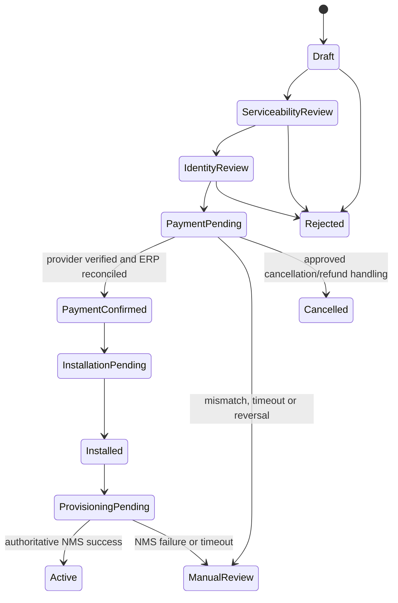

# Customer Self-Care Enrollment Contract

**Status:** Design contract for the next implementation slice. No public self-care API, payment adapter, or activation worker is implemented by this document.

## Boundary and canonical records

Each ISP client is a separate Frappe site/database. The authenticated site connection selects the tenant; a request body must never select another tenant. Google login proves the identity session only. The identity service must resolve that identity to an approved tenant membership before the gateway calls this tenant's private Frappe API.

Keep the existing records canonical:

- ERPNext Lead owns prospect contact/profile data.
- ERPNext Address owns service/billing address data and links to the Lead until conversion.
- ERPNext Item owns the service plan.
- ISP Acquisition Request owns the onboarding workflow and links to Lead, Address and Item.
- ERPNext Customer and Sales Order own the bill-to party and commercial order after the approved conversion point.
- ERPNext Payment Request and Payment Entry own payment request and accounting evidence.
- ISP Service Order owns the operational provisioning request and its NMS projection.
- ISP Integration Event is the transactional outbox reference; it carries document references, not copied profile/payment payloads.

Do not create a second customer, invoice, payment ledger, or mutable payment status in the Go identity service or mobile app.

## State machine

PaymentConfirmed is not a client-supplied field and not proof by itself that a service is live. The transition requires a valid provider event, amount/currency/order correlation, duplicate/replay check, and ERPNext reconciliation. Provisioning completion requires an authoritative result from the supported NMS interface. Until that contract is verified, keep the service pending/manual review.

Identity method is independently policy-gated. Aadhaar offline/e-KYC remains disabled unless the operator has confirmed eligibility, a compliant provider/process, and approved configuration. Store only a minimal verification result/reference; never upload/store the source Aadhaar artifact, QR/XML, biometrics, or OTP in this app.

## Proposed versioned API boundary

Expose these routes only through the authenticated Go API/BFF. The BFF derives tenant and identity from the server-validated session and routes to that tenant's private Frappe site. Do not expose Frappe credentials or internal site URLs to the Flutter app.

| Route | Purpose | Contract and authorization |
|---|---|---|
| GET /v1/self-care/plans?service_location=... | Show currently sellable plans | Customer session; location inputs are validated and serviceability is rechecked on submit. Return a small public plan projection, not ERPNext documents. |
| POST /v1/self-care/acquisitions | Create/resume a request | Customer session; UUID idempotency key; accepts plan ID, address fields, consent version/receipt and approved identity method. Server creates/reuses Lead, Address and one Acquisition Request transactionally within the tenant site. Never accepts customer, tenant, payment status, ERP document status, or verification result from client. |
| GET /v1/self-care/acquisitions/{id} | Show progress | Owning customer only; return allowlisted state and next action, never ERPNext raw documents or another user's data. |
| POST /v1/self-care/acquisitions/{id}/payment-request | Request payment intent | Owning customer; only after serviceability, identity and commercial checks. ERPNext creates/owns Payment Request. Return provider redirect/token only if the selected provider integration supports it; do not store card/UPI secrets. |
| POST /v1/webhooks/payments/{provider} | Accept payment events | Provider signature verification, timestamp/replay controls, event idempotency, exact order/amount/currency matching, and reconciliation to the canonical ERPNext Payment Request/Payment Entry. This is provider-specific and remains disabled until selected and approved. |
| GET /v1/self-care/services | Show active services and order state | Owning customer only; read from ERPNext/operations projections with service activation only after authoritative NMS state. |

All API payloads are bounded and schema-versioned. Apply per-identity and per-tenant rate limits, audit correlation IDs, avoid logging personal/payment payloads, and return opaque error codes. BFF retries must be idempotent; no blind retry may create a second Lead, request, Payment Request, or service order.

## Safe sequencing and compensating actions

1. Validate plan availability and serviceability. This is a decision result, not a promise of network coverage.
2. Create/reuse the Lead and linked Address, then create one Draft/Serviceability Review Acquisition Request with an idempotency key.
3. Record consent policy version and receipt metadata only after the approved consent UX. Consent fields are not proof of identity.
4. Complete the operator-approved identity process and persist only the result/reference.
5. Create the commercial order and ERPNext Payment Request only after configured checks. Payment initiation is not payment confirmation.
6. Verify provider event against the ERPNext order/request; record/reconcile ERPNext Payment Entry before moving to payment-confirmed workflow.
7. Schedule installation if required. Create a single ISP Service Order only after required checks and technician/installation completion.
8. Publish its reference-only outbox event. NMS adapter processes only against the verified product API and idempotency contract.
9. Mark active only from authoritative NMS success and the approved activation policy. Billing commencement follows the approved service activation/billing rule.

If payment succeeds but downstream onboarding fails, the request goes to a visible exception/refund-review state. Never silently create another payment request or charge. Refunds/reversals are recorded through ERPNext and the selected payment provider's confirmed process.

## Tenant and privacy controls

- Resolve tenant from authenticated membership and server configuration, never an app-supplied tenant ID.
- Use least-privilege service credentials per client site; the gateway cannot connect directly to another tenant's database.
- Scope every acquisition lookup to the authenticated owner or explicitly authorized ISP staff.
- Minimize returned customer data and maintain access/audit records without storing full document or payment payloads.
- Public repository source may reveal architecture and schemas; private credentials, OAuth client secrets, signing keys, payment secrets, customer data, and runtime configuration stay outside GitHub.

## Release acceptance gates

Before calling self-care operational:

- A verified Google identity with no customer membership can create one pending customer onboarding workflow without gaining staff permissions.
- Same idempotency key replays the same acquisition; concurrent duplicate submits do not create duplicate Leads, Addresses, requests, or Payment Requests.
- One tenant cannot read or mutate another tenant's acquisition, even when IDs are guessed.
- Provider event signature failure, replay, amount mismatch, wrong currency/order, duplicate event, timeout, success, reversal/refund, and ERP reconciliation failure each produce a deterministic auditable result.
- No client payload can set identity verification, payment confirmation, service status, tenant, customer ownership, or NMS state.
- A service remains non-active and non-billable when payment is merely initiated, ERP reconciliation is incomplete, installation is outstanding, or NMS success is unconfirmed.
- Retention, consent wording, DoT/UIDAI identity path, payment provider, GST/accounting treatment and support escalation are signed off by the relevant operator/compliance owners.
- The implementation is built and integration-tested against pinned Frappe/ERPNext and provider versions before production use.

## Required decisions before enabling writes

- Public OMISHA HTTPS domain and verified Android App Links.
- Payment provider, webhook signature scheme, supported payment modes, refund/reversal callbacks, settlement/reconciliation rules and currency behavior.
- Whether prepaid, postpaid, deposit, installation charge, recurring billing, or usage-based billing applies.
- Serviceability data source and who can approve exceptions.
- Applicable operator identity requirements and eligible compliant verification method.
- Installed NMS Prime product/version and its supported provisioning/idempotency/readback API.
- Customer privacy/consent text, retention schedule, support policy and lawful reporting/accounting treatment.
