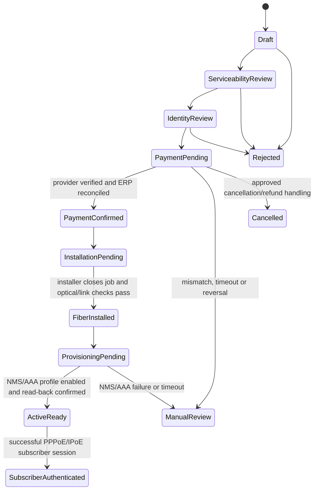

# Customer Self-Care Enrollment Contract

**Status:** Design contract for the next implementation slice. No public self-care API, payment adapter, or activation worker is implemented by this document.

## Boundary and canonical records

Each ISP client is a separate Frappe site/database. The authenticated site connection selects the tenant; a request body must never select another tenant. Google login proves the identity session only. The identity service must resolve that identity to an approved tenant membership before the gateway calls this tenant's private Frappe API.

Keep the existing records canonical:

- ERPNext Lead owns prospect contact/profile data.
- ERPNext Address owns service/billing address data and links to the Lead until conversion.
- ERPNext Item owns the service plan.
- ISP Acquisition Request owns the onboarding workflow and links to Lead, Address and Item.
- ERPNext Customer and Sales Order own the bill-to party and commercial order after the approved conversion point.
- ERPNext Payment Request and Payment Entry own payment request and accounting evidence.
- ISP Service Order owns the operational provisioning request and its NMS projection.
- ISP Integration Event is the transactional outbox reference; it carries document references, not copied profile/payment payloads.

Do not create a second customer, invoice, payment ledger, or mutable payment status in the Go identity service or mobile app.

## State machine

PaymentConfirmed is not a client-supplied field and does not itself activate service. The transition requires a valid provider event, amount/currency/order correlation, duplicate/replay check, and ERPNext reconciliation. Fiber installation is then completed at the customer's premises and the technician closes the job with ONT/optical signal and port/link checks. The ISP service becomes Active/Ready only after the subscriber profile is enabled in the actual access authentication path and a read-back/health confirmation succeeds. The customer can then authenticate through the CPE/router using the ISP's selected subscriber access method. The first successful session is tracked separately from activation.

Do not treat an end-customer's broadband credentials as credentials for the ISP router's administrative interface. In a common PPPoE design, the customer configures WAN PPPoE credentials in their ONT/router; the access concentrator/BNG forwards authentication to a RADIUS/AAA service, which checks the subscriber profile and returns allowed policy. IPoE/DHCP with a defined AAA mechanism is another possible design. The exact access method, BNG/OLT/ONT vendors and profile attributes must be confirmed. If by “login to ISP router” the user means accessing a managed router's admin console, that is a separate privileged operation and must not use subscriber credentials.

The official NMS Prime Community Edition source documents FTTH/DSL/WiFi provisioning via TR-069 and RADIUS, CPE/modem management, and BNG/BRAS/IP-pool/QoS operations. Its official REST/JSON API documentation lists `/admin/api/v0/{Object}` routes. This supports the intended zero-touch design direction, but the customer's installed edition/release, ONT models, API schema and actual OLT/BNG/ACS/AAA topology still need confirmation. TR-369/USP is not claimed as supported by the pinned NMS Prime release. Treat TR-069 CPE management and subscriber access authorization via BNG/RADIUS as distinct functions. Until host API schemas and repeat-safe effects are verified, keep provisioning pending/manual review.

Identity method is independently policy-gated. Aadhaar offline/e-KYC remains disabled unless the operator has confirmed eligibility, a compliant provider/process, and approved configuration. Store only a minimal verification result/reference; never upload/store the source Aadhaar artifact, QR/XML, biometrics, or OTP in this app.

## Proposed versioned API boundary

Expose these routes only through the authenticated Go API/BFF. The BFF derives tenant and identity from the server-validated session and routes to that tenant's private Frappe site. Do not expose Frappe credentials or internal site URLs to the Flutter app.

| Route | Purpose | Contract and authorization |
|---|---|---|
| GET /v1/self-care/plans?service_location=... | Show currently sellable plans | Customer session; location inputs are validated and serviceability is rechecked on submit. Return a small public plan projection, not ERPNext documents. |
| POST /v1/self-care/acquisitions | Create/resume a request | Customer session; UUID idempotency key; accepts plan ID, address fields, consent version/receipt and approved identity method. Server creates/reuses Lead, Address and one Acquisition Request transactionally within the tenant site. Never accepts customer, tenant, payment status, ERP document status, or verification result from client. |
| GET /v1/self-care/acquisitions/{id} | Show progress | Owning customer only; return allowlisted state and next action, never ERPNext raw documents or another user's data. |
| POST /v1/self-care/acquisitions/{id}/payment-request | Request payment intent | Owning customer; only after serviceability, identity and commercial checks. ERPNext creates/owns Payment Request. Return provider redirect/token only if the selected provider integration supports it; do not store card/UPI secrets. |
| POST /v1/webhooks/payments/{provider} | Accept payment events | Provider signature verification, timestamp/replay controls, event idempotency, exact order/amount/currency matching, and reconciliation to the canonical ERPNext Payment Request/Payment Entry. This is provider-specific and remains disabled until selected and approved. |
| GET /v1/self-care/services | Show active services and order state | Owning customer only; read from ERPNext/operations projections with service activation only after authoritative NMS state. |

All API payloads are bounded and schema-versioned. Apply per-identity and per-tenant rate limits, audit correlation IDs, avoid logging personal/payment payloads, and return opaque error codes. BFF retries must be idempotent; no blind retry may create a second Lead, request, Payment Request, or service order.

## Safe sequencing and compensating actions

1. Validate plan availability and serviceability. This is a decision result, not a promise of network coverage.
2. Create/reuse the Lead and linked Address, then create one Draft/Serviceability Review Acquisition Request with an idempotency key.
3. Record consent policy version and receipt metadata only after the approved consent UX. Consent fields are not proof of identity.
4. Complete the operator-approved identity process and persist only the result/reference.
5. Create the commercial order and ERPNext Payment Request only after configured checks. Payment initiation is not payment confirmation.
6. Verify provider event against the ERPNext order/request; record/reconcile ERPNext Payment Entry before moving to payment-confirmed workflow.
7. Schedule installation if required. Create a single ISP Service Order only after required checks and technician/installation completion.
8. Publish its reference-only outbox event. NMS adapter processes only against the verified product API and idempotency contract.
9. NMS/operations adapter provisions the subscriber profile to the verified access/AAA path. Require idempotency, status read-back and an explicit success response; never activate based only on “request sent”.
10. Mark Active/Ready after the fiber job is closed, optical/link checks pass, and the access profile is enabled/read back. Give the customer the approved WAN subscriber configuration through a secure channel; do not expose router administration credentials.
11. No customer credential entry is required. The installed ONT/router securely checks in to the approved device-management controller (ACS via TR-069/CWMP or USP Controller via TR-369, if supported by that device); the service workflow matches the device to the installation/service order and pushes the approved configuration. The router brings up its subscriber WAN automatically (PPPoE or IPoE as selected); BNG/NAS and RADIUS/AAA enforce subscriber authorization. Accounting/session state is correlated to the service. Billing commencement follows the approved activation rule; first successful session is independently auditable.

If payment succeeds but downstream onboarding fails, the request goes to a visible exception/refund-review state. Never silently create another payment request or charge. Refunds/reversals are recorded through ERPNext and the selected payment provider's confirmed process.

## Tenant and privacy controls

- Resolve tenant from authenticated membership and server configuration, never an app-supplied tenant ID.
- Use least-privilege service credentials per client site; the gateway cannot connect directly to another tenant's database.
- Scope every acquisition lookup to the authenticated owner or explicitly authorized ISP staff.
- Minimize returned customer data and maintain access/audit records without storing full document or payment payloads.
- Public repository source may reveal architecture and schemas; private credentials, OAuth client secrets, signing keys, payment secrets, customer data, and runtime configuration stay outside GitHub.

## Release acceptance gates

Before calling self-care operational:

- A verified Google identity with no customer membership can create one pending customer onboarding workflow without gaining staff permissions.
- Same idempotency key replays the same acquisition; concurrent duplicate submits do not create duplicate Leads, Addresses, requests, or Payment Requests.
- One tenant cannot read or mutate another tenant's acquisition, even when IDs are guessed.
- Provider event signature failure, replay, amount mismatch, wrong currency/order, duplicate event, timeout, success, reversal/refund, and ERP reconciliation failure each produce a deterministic auditable result.
- No client payload can set identity verification, payment confirmation, service status, tenant, customer ownership, or NMS state.
- A service remains non-active and non-billable when payment is merely initiated, ERP reconciliation is incomplete, fiber installation/optical checks are outstanding, or NMS-to-AAA provisioning read-back is unconfirmed.
- A provisioned customer can authenticate with the approved PPPoE/IPoE subscriber method; invalid credentials are rejected, the correct service policy is applied, and session/accounting events map to the right service. Subscriber credentials cannot log into router administration.
- Retention, consent wording, DoT/UIDAI identity path, payment provider, GST/accounting treatment and support escalation are signed off by the relevant operator/compliance owners.
- The implementation is built and integration-tested against pinned Frappe/ERPNext and provider versions before production use.

## Required decisions before enabling writes

- Public OMISHA HTTPS domain and verified Android App Links.
- Payment provider, webhook signature scheme, supported payment modes, refund/reversal callbacks, settlement/reconciliation rules and currency behavior.
- Whether prepaid, postpaid, deposit, installation charge, recurring billing, or usage-based billing applies.
- Serviceability data source and who can approve exceptions.
- Applicable operator identity requirements and eligible compliant verification method.
- Exact NMS Prime product/vendor/version and whether it provisions access profiles or only manages devices; its supported API and idempotency/read-back behavior.
- Access topology: OLT/ONT, BNG/BRAS/NAS, PPPoE vs IPoE, RADIUS/AAA ownership, accounting/session updates, and whether customer CPE is OMISHA/ISP-managed.
- What “TR2” means in the operator's equipment: TR-069/CWMP, TR-369/USP, a vendor-specific protocol, or another system. Confirm ONT/router model, supported agent, ACS/controller endpoint, secure bootstrap credentials/certificates, data model and factory-reset/replacement procedure.
- Customer privacy/consent text, retention schedule, support policy and lawful reporting/accounting treatment.

## Fiber installation and broadband authentication

The customer journey is: payment reconciled → technician installs fiber and records ONT/optical/link test → service order is submitted to the NMS/access and device-management adapters → the ONT/router securely auto-registers with the approved ACS/USP controller → controller applies the correct service profile → BNG/NAS and RADIUS/AAA authorize the router's subscriber session → successful read-back/session check sets the service Active/Ready. The customer does not enter PPPoE credentials or log in to router administration.

NMS Prime is an unverified integration label in this repository. It could be a network management product, an NMS custom system, or another product. Do not hard-code it as the subscriber authentication authority until operator confirms its exact identity and API. In a broadband design using PPPoE, authentication is usually performed by the BNG/NAS and an AAA/RADIUS service; NMS may provision that profile through a supported API. Cisco's documentation describes BNG subscriber management as handling identification, address assignment, authentication, authorization and accounting, while FreeRADIUS documentation describes the RADIUS server processing a login initiated by a remote user's PPP/802.1X link. These are reference architecture examples, not confirmation of this ISP's deployed equipment.

Required private integration contract (to be completed after vendor/version discovery):

- Provision request: service UUID, access-circuit/ONT reference, plan/profile ID, subscriber credential reference (never plaintext in logs), idempotency key and correlation ID.
- Result/read-back: accepted/rejected, authoritative external profile/session ID, applied policy/profile version, timestamp and sanitized failure code.
- Device onboarding: TR-069/CWMP or TR-369/USP agent/controller support, mutual authentication/credential bootstrap, service-order-to-device matching, config profile read-back, and secure replacement/reset process. Customer should not receive device-management or router-admin secrets.
- Subscriber authentication: chosen PPPoE/IPoE flow with credentials provisioned to the router automatically, or an approved device-bound IPoE model; BNG/RADIUS policy, accounting/session updates, and lockout/rate-limit policy.
- Accounting/session: start/stop/interim updates, NAS/BNG identity, session ID, assigned address and byte counters as permitted; reconcile duplicates and late events without copying high-volume raw logs into every business system.
- Operations safety: rollback/disable procedure, manual recovery queue, credential rotation and outage behavior. NMS/AAA failure must not create a false Active state.

References:
- Cisco BNG subscriber management overview: https://www.cisco.com/c/en/us/td/docs/net_mgmt/prime/network/5-1/user/guide/CiscoPrimeNetwork51UserGuide/bng.html
- Cisco Prime Infrastructure device access and external RADIUS/TACACS+ user authentication: https://www.cisco.com/c/en/us/td/docs/net_mgmt/prime/infrastructure/3-10/admin/cisco_prime_infrastructure_3_10_admin_guide/user_permissions_and_device_access.html
- FreeRADIUS session concepts (PPP/802.1X link, NAS request, RADIUS verification): https://www.freeradius.org/documentation/freeradius-server/3.2.9/concepts/session/radius_session.html

## Automatic ONT/router registration (customer does nothing)

“TR2” likely refers to TR-069, which the official NMS Prime Community Edition documentation lists for FTTH/DSL/WiFi CPE provisioning. The project source is pinned to `cablelabs/os-provisioning` commit `117cf48e917681c6c47ba966132c2fbf1e606f4b`; confirm the deployed edition/release, ONT model and ACS support before implementation. TR-369 support is not inferred from this repository.

- Technician scans/records ONT/router model and device identifiers against the installation job; server checks they are expected for that service and network location.
- ONT authentication/registration to the access network and router management check-in are separate proofs. The access network uses the operator's OLT/ONT registration method; the management plane uses the device's supported ACS/USP trust/bootstrap method.
- The provisioning controller maps the authenticated device to one service order, applies the approved WAN/service profile and reports configuration read-back. It must not use customer-entered credentials or infer tenant from a device-supplied account field.
- The CPE then starts its WAN subscriber session automatically. BNG/NAS and the selected AAA/RADIUS system authorize the service; session/accounting events return to OMISHA operations for service status and billing correlation.
- A failed, unknown, duplicated, replaced, or factory-reset device remains Pending/Manual Review. Never auto-attach an unknown device to a customer using serial number alone.
- Device management credentials/certificates and subscriber credentials are different secrets. Keep them encrypted and scoped, redact them from logs, rotate/revoke on replacement or compromise, and never expose ACS/USP credentials to customers.
- Release acceptance requires the exact ONT/router models and access topology in a lab or controlled pilot, including first boot, duplicate serial, wrong service, interrupted check-in, reset/replacement, configuration mismatch, AAA rejection, and retry/recovery.

NMS Prime references:
- Official project source (the old `nmsprime/nmsprime` repository says it moved here): https://github.com/cablelabs/os-provisioning
- Official NMS Prime API documentation: REST/JSON, `/admin/api/v0/{Object}`, HTTP Basic Auth; documented default `api@localhost` user can create/modify/delete all objects, and fine-grained API permissions are described as planned: https://nmsprime.atlassian.net/wiki/spaces/NMS/pages/8522192/NMS+Prime+API
- Official OS Provisioning overview: CPE/modem online workflow, TR-069/ACS diagnostics, BNG/BRAS/IP pools/QoS, and RADIUS-based FTTH speed enforcement: https://nmsprime.atlassian.net/wiki/spaces/NMS/pages/1097072648/Overview+OS+Provisioning

Broadband Forum references:
- TR-069/CWMP defines CPE-to-ACS secure auto-configuration and dynamic service provisioning: https://www.broadband-forum.org/pdfs/tr-069-1-6-0.pdf
- TR-369/USP defines Agent and Controller management roles: https://www.broadband-forum.org/pdfs/tr-369-1-3-1.pdf
- Broadband Forum TR-369 technical library identifies the current in-force revision; use the deployed device's supported revision during implementation: https://www.broadband-forum.org/technical-library?number=TR-369
